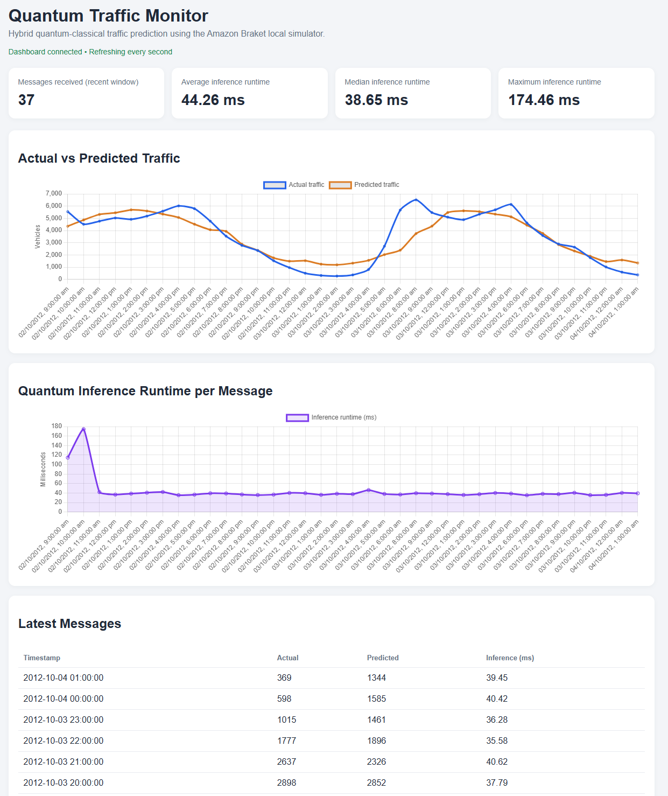
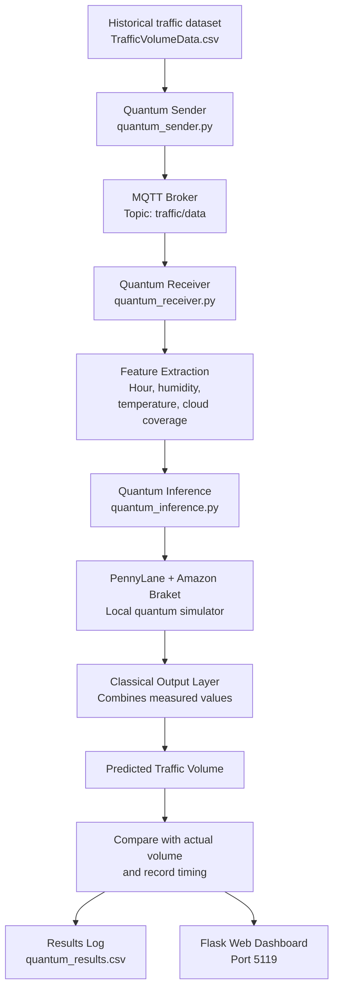
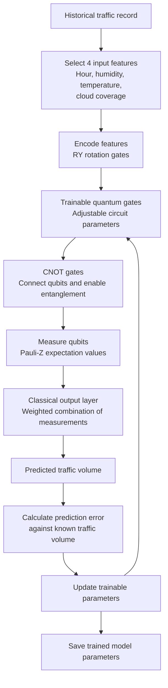

# Quantum Traffic Prediction with MQTT

A demonstration of **hybrid quantum-classical machine learning** for traffic-volume prediction.

This project shows how historical traffic data can be sent through an MQTT pipeline, processed by a quantum machine learning circuit running on a local simulator, and displayed on a live dashboard.

The key question this project demonstrates is:

> **How can a quantum circuit become part of a machine learning model that predicts traffic volume from weather and time-related data?**

**Important:** This is a research and educational prototype. The quantum circuit runs on Amazon Braket's local simulator. It does not use a paid quantum computer or demonstrate quantum advantage over classical machine learning.

## 1. What does the visitor see?



The dashboard displays actual and predicted traffic volumes, inference timings, and recent messages received by the system.

During the demonstration, the sender replays historical traffic records. Each record travels through MQTT to the receiver, which uses the trained hybrid model to generate a prediction.

The dashboard then displays the prediction alongside the known traffic volume in that historical record.

This is a replay of historical data, not a connection to a live traffic sensor.

## 2. System architecture: from traffic data to dashboard

This diagram shows the complete journey of a traffic record through the application.



The model is trained separately before the demonstration. The trained parameters are saved to `quantum_model_params.npz` and loaded by the inference module when the receiver starts.

**The important point:** MQTT transports the data, the quantum circuit processes the encoded features, the classical output layer turns the circuit's measurements into a prediction, and the dashboard presents the result.

## 3. Where exactly is quantum computing used?

Quantum computing is used inside the **prediction stage**, specifically when the model executes its parameterized quantum circuit.

It is not used by MQTT, the Flask dashboard, or the CSV replay mechanism.

The project uses four qubits. Each qubit is a quantum computing unit whose state can be manipulated by quantum gates and measured to obtain information used by the model.

The quantum circuit does not directly output a traffic-volume number. Instead, it produces measurement values that the classical part of the model uses to calculate the final prediction.

## 4. Inside the hybrid quantum-classical model

This second diagram zooms in on the machine learning process.



*During training, the model adjusts its parameters to reduce prediction error. During inference, it uses the learned parameters to make predictions without repeating the training process.*

### Step 1 — Prepare the input data

The model uses four features from each traffic record:

| Feature | What it represents |
|---|---|
| Hour | Hour of the day derived from `date_time` |
| Humidity | Recorded humidity |
| Temperature | Recorded temperature |
| Cloud coverage | The `clouds_all` value |

The target is `traffic_volume`, the traffic volume the model is learning to predict.

### Step 2 — Encode the features into qubits

A classical computer represents these features as numerical values. The quantum circuit then uses **RY rotation gates** to encode the input values into the states of four qubits.

An RY gate rotates a qubit's state around the Y axis of the Bloch sphere. The rotation angle controls the resulting quantum state.

In this prototype, the encoding connects the input data to the quantum circuit. It does not mean the data is automatically made more informative or that quantum encoding guarantees better predictions.

### Step 3 — Apply trainable quantum gates

The circuit applies trainable rotation operations whose parameters are adjusted during model training.

These parameters influence the quantum states and therefore influence the results obtained when the qubits are measured.

The training process searches for parameter values that help the overall model predict traffic volume more accurately.

### Step 4 — Connect qubits using CNOT gates

CNOT is a controlled-NOT quantum gate. It acts on a pair of qubits, applying a NOT operation to the target qubit when the control qubit is in the appropriate computational-basis state.

Within the circuit, CNOT gates allow interactions between qubits and can create entanglement.

Entanglement is a specifically quantum correlation between parts of a quantum state. In this model, the gates provide a way for the circuit to represent relationships among its qubits.

Their presence alone does not prove that the model performs better than a classical alternative.

### Step 5 — Measure the qubits

After the circuit's quantum operations, the model measures Pauli-Z expectation values.

For an individual qubit, the Pauli-Z observable assigns:

- \(+1\) to the computational basis state \(|0\rangle\)
- \(-1\) to the computational basis state \(|1\rangle\)

The expectation value is the average observable value implied by the quantum measurement distribution. With finite-shot sampling, the simulator estimates it from measurement outcomes.

The resulting values are numerical features produced by the quantum circuit. They are not yet the traffic-volume prediction.

### Step 6 — Calculate the final prediction classically

A classical linear output layer combines the quantum measurement values using learned weights and a bias to produce the predicted traffic volume.

Conceptually, the output has the form:

\[
\hat{y} = \sum_i w_i z_i + b
\]

Here, \(z_i\) represents a quantum measurement value, \(w_i\) is a learned classical weight, and \(b\) is a bias. The result \(\hat{y}\) is the predicted traffic volume.

This is why the project is called **hybrid quantum-classical machine learning**: quantum operations produce intermediate features, while classical computation helps turn those features into the final prediction.

## 5. How does training make the model learn?

Training and prediction are two different stages.

**Training** uses historical examples for which the actual traffic volume is known. The model makes predictions, compares them with the known values, calculates prediction error, and adjusts its trainable parameters to reduce that error.

Both the quantum circuit parameters and classical output-layer parameters participate in the hybrid learning process.

The trained parameters are saved to `quantum_model_params.npz`.

**Inference** loads those learned parameters and uses them to predict traffic volume for incoming records. The receiver does not need to train the model again for every MQTT message.

The training script is `quantum_model.py`; inference is implemented in `quantum_inference.py`.

## 6. How the software components fit together

| Component | Responsibility |
|---|---|
| `quantum_model.py` | Trains and evaluates the hybrid model and saves its learned parameters |
| `quantum_inference.py` | Loads the parameters and runs the quantum prediction path |
| `quantum_sender.py` | Replays historical traffic records over MQTT |
| `quantum_receiver.py` | Receives messages, invokes inference, records results, and serves the dashboard |
| MQTT broker | Transports messages on the `traffic/data` topic |
| `templates/quantum_index.html` | Defines the dashboard interface |
| `quantum_results.csv` | Stores processed prediction records and timing information |
| `quantum_model_params.npz` | Stores trained model parameters; generated locally |

## 7. Prototype training results

In one development run, the model was trained for five epochs using a limited subset of the available dataset.

| Metric | Development result |
|---|---:|
| Training epochs | 5 |
| Training examples | Up to 128 |
| Test examples | 32 |
| Test MAE | 1,031.77 vehicles |
| Test R² | 0.5173 |

These are results from a small prototype experiment, not a comprehensive benchmark. They do not establish that the quantum model outperforms a classical model.

The dashboard's inference timing measures the prediction path, while total processing timing includes additional receiver-side work. The first inference can take longer because of initialization.

## 8. Technology stack

- Python
- PennyLane
- Amazon Braket SDK and PennyLane plugin
- Braket local quantum simulator
- NumPy, pandas, and scikit-learn
- Paho MQTT
- Flask
- Chart.js

All quantum circuit execution in this prototype is local. No remote quantum hardware or paid cloud quantum jobs are required.

## 9. Dataset

The project uses the [TrafficVolumeDataCSV dataset on Kaggle](https://www.kaggle.com/datasets/bobaaayoung/trafficvolumedatacsv/data).

Download the CSV and place it in the repository root as:

```text
TrafficVolumeData.csv
```

The dataset is not included in this repository. Consult the dataset's source page for its applicable terms.

## 10. Setup and running the demonstration

### Requirements

- Python 3.10
- An MQTT broker reachable at `127.0.0.1:1884`
- `TrafficVolumeData.csv`
- Python dependencies from `requirements.txt`

### Clone the repository

```bash
git clone https://github.com/aimanhaizal/quantum-traffic-mqtt.git
cd quantum-traffic-mqtt
```

### Create a virtual environment and install dependencies

```bash
python3 -m venv .venv
source .venv/bin/activate
python -m pip install -r requirements.txt
```

On Windows PowerShell, activate the environment with:

```powershell
.\.venv\Scripts\Activate.ps1
```

Download the dataset and place it in the repository root.

### Step 1: Train the model

```bash
python quantum_model.py
```

This trains and evaluates the model and creates `quantum_model_params.npz`.

Run this step when setting up a fresh copy of the project or when you want to train a new model.

### Step 2: Start the MQTT broker

If the existing Mosquitto Docker container is used:

```bash
docker start mosquitto
```

Make sure the broker is reachable at the address and port configured by the sender and receiver.

### Step 3: Start the receiver

In one terminal:

```bash
cd /home/work/quantum-traffic-mqtt
source .venv/bin/activate
python quantum_receiver.py
```

The receiver subscribes to `traffic/data`, performs predictions, logs results, and serves the Flask dashboard.

### Step 4: Start the sender

In a second terminal:

```bash
cd /home/work/quantum-traffic-mqtt
source .venv/bin/activate
python quantum_sender.py
```

The sender publishes valid rows from the CSV at approximately one-second intervals. Press `Ctrl+C` to stop the replay.

### Step 5: Open the dashboard

Visit [http://localhost:5119/](http://localhost:5119/).

When accessing the dashboard from another machine, use the host's reachable IP address and port `5119`, for example `http://10.1.32.1:5119/`.

## 11. Scope and limitations

- This is a prototype demonstrating quantum machine learning integration, not a production traffic forecasting service.
- The quantum circuit runs on a local simulator, not physical quantum hardware.
- The dataset replay uses historical observations rather than live traffic sensor data.
- The model is trained on a small subset for demonstration purposes.
- No comparison in this project establishes a quantum advantage over classical machine learning.
- Simulator and inference timings depend on the computer, software environment, and execution conditions.
- The dashboard requires browser access to the external Chart.js CDN.

## 12. The main takeaway

The quantum component is not the entire application. It is a specific stage inside the machine learning model.

**Historical data → feature encoding → quantum circuit operations → quantum measurements → classical output layer → traffic-volume prediction.**

The purpose of this demonstration is to make that hybrid workflow visible: a quantum circuit processes encoded input features, its measurement results become inputs to classical prediction logic, and the resulting prediction travels through an MQTT-based application to a live dashboard.

## License

The repository's code is released under the MIT License. See [`LICENSE`](LICENSE). The dataset is a separate work and remains subject to the terms of its source.
