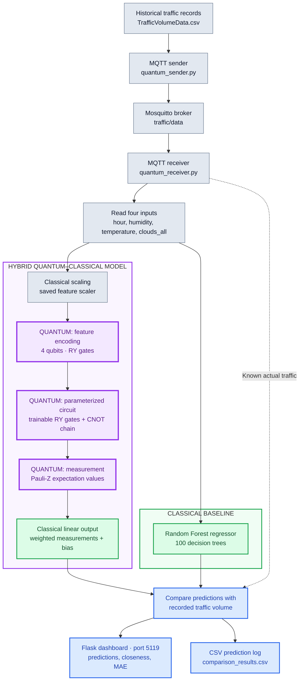
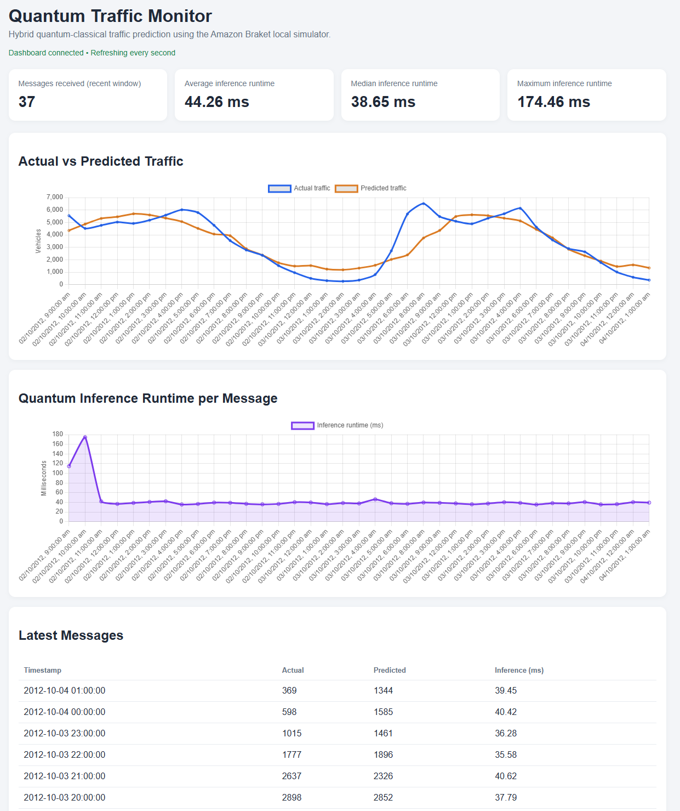
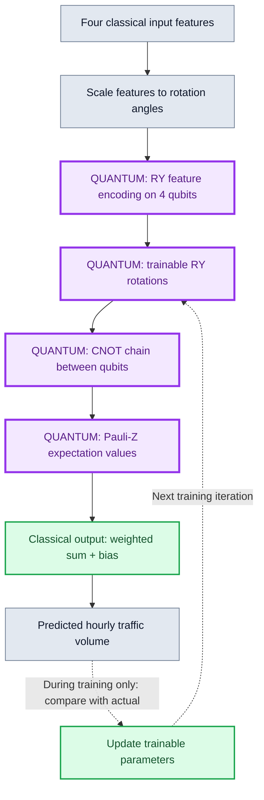

# Quantum Traffic Prediction with MQTT

**A demonstrable hybrid quantum–classical machine learning prototype:** historical traffic records are streamed through MQTT and predicted by **two models in parallel**—a four-qubit quantum–classical regressor and a conventional Random Forest. The Flask dashboard displays actual traffic, both predictions, and their errors.

> **The question this project answers:** *Where exactly is quantum computing used, and what does it contribute to the traffic prediction workflow?*
>
> **Short answer:** The purple steps in the diagram below. The receiver passes four numerical features into a **PennyLane quantum circuit executed with the Amazon Braket local simulator**. The circuit encodes the inputs into four qubits, applies quantum gates, and returns measured expectation values. A **classical output layer** then converts these values into a traffic-volume prediction. The Random Forest uses the same four inputs but **does not run a quantum circuit**.

**Research/demo scope:** The traffic readings are **historical records replayed through MQTT**, not live road sensors. Quantum operations are **simulated locally on a conventional computer**, not executed on real quantum hardware. This work does **not** claim quantum advantage.

## Start the demonstration (Docker Compose)

**Already set up on this workstation?** From the repository directory, with `TrafficVolumeData.csv`, `quantum_model_params.npz`, and `classical_model.pkl` already present:

```bash
docker compose up -d --build
```

Open **[http://127.0.0.1:5119/](http://127.0.0.1:5119/)** on the machine running Docker. The sender begins the historical replay automatically; the Mosquitto broker, receiver, and dashboard start in containers. No separate broker or Python terminal is needed.

```bash
# See container status
docker compose ps

# Follow the live predictions (Ctrl+C stops viewing logs, not containers)
docker compose logs -f receiver

# Stop the demonstration when finished
docker compose down
```

**New clone or missing model files?** Complete [First-time setup](#first-time-setup-new-clone) below **before** running `docker compose up -d --build`. The three local files are not committed to Git. The initial quantum training may be computationally slow because it repeatedly simulates quantum circuits; it is **not** part of normal demo startup. Docker Compose does not automatically retrain the models.

## Where quantum computing happens — color-coded architecture

**Purple = quantum circuit execution** · **Green = classical ML/computation** · **Grey = data transport and preparation** · **Blue = results/dashboard**.



**What is actually “quantum” here?** Inside `quantum_inference.py`, PennyLane builds a four-qubit circuit on the `braket.local.qubit` device. The encoded inputs go through `RY` rotations, trainable `RY` rotations, and a CNOT chain. The simulator returns four **Pauli-Z expectation values** (using finite-shot simulation); classical weights and a bias turn those four numbers into predicted traffic volume. The quantum circuit is also called repeatedly during training in `quantum_model.py`. **MQTT, the CSV dataset, Flask, Docker, and Random Forest do not perform quantum operations.**

**Training vs live demonstration:** `quantum_model.py` trains and saves parameters in `quantum_model_params.npz`; `classical_model.py` trains and saves `classical_model.pkl`. During the demonstration, `quantum_receiver.py` **loads** those artifacts and calls the inference code—it does **not** retrain either model on incoming messages.

## What visitors see

The dashboard at **http://127.0.0.1:5119/** plots three series: **actual recorded traffic** (blue), **quantum prediction** (purple), and **Random Forest prediction** (green). It includes the running **prediction closeness percentage**, **mean absolute error (MAE)** in vehicles, and a short explanation of the four inputs. Technical visitors can expand an optional inference-runtime section.



The dataset contains recorded traffic volumes, so they can be used as the reference when scoring each replayed prediction. This is a **historical replay**, not live traffic forecasting.

### Four inputs, one prediction target

| Input | What the model receives | Why it can be relevant |
|---|---|---|
| **Hour** | Hour of day (`0`–`23`), extracted from `date_time` | Helps model daily traffic patterns. |
| **Humidity** | `humidity` from the dataset | Weather context. |
| **Temperature** | `temperature` from the dataset (Kelvin) | Weather context. |
| **Cloud coverage** | `clouds_all` from the dataset (`0`–`100`) | Weather context. |

**Target:** `traffic_volume`, the recorded hourly traffic volume. Both models use **exactly these same four features**; the actual traffic volume is used to evaluate predictions, not supplied as a model input.

## How the quantum model works

The four-qubit model is **hybrid**: quantum circuit measurements are used as inputs to a classical output layer. This is an educational proof of concept, not a claim that a quantum circuit gives better forecasts.



The circuit does **not** output traffic volume directly. Instead, it produces four numerical expectation values, which a learned classical linear layer combines:

$$
\hat{y} = \sum_i w_i z_i + b
$$

Here, $z_i$ is a quantum-circuit measurement, $w_i$ a classical output weight, and $b$ the bias. The output is converted back to the dataset's traffic-volume scale.

### What are RY, CNOT, and Pauli-Z?

- **RY rotation:** rotates a qubit's state; input-feature values determine feature-encoding rotation angles, while separate learned parameters control trainable rotations.
- **CNOT:** a two-qubit gate allowing interactions between qubits, which can generate entanglement. Using CNOT does not by itself prove an accuracy advantage.
- **Pauli-Z expectation:** an average observable value in the range `-1` to `+1`, estimated here with the local simulator's finite shots. These are intermediate numbers, not vehicle counts.

### Files that actually use quantum circuits

| File | Purpose |
|---|---|
| `quantum_model.py` | Trains and evaluates the hybrid quantum–classical model using PennyLane and the Amazon Braket local simulator. Saves `quantum_model_params.npz`. |
| `quantum_inference.py` | Loads trained parameters and executes the same four-qubit circuit for each incoming traffic record. |
| `quantum_circuit_test.py` | Standalone circuit experimentation/testing, not part of the live MQTT pipeline. |

## Comparing quantum and classical machine learning

`classical_model.py` trains a **Random Forest regressor (100 trees)** as the baseline and saves `classical_model.pkl`. `classical_inference.py` loads the model and predicts from the same input features used by the quantum path. `quantum_receiver.py` runs both paths for every MQTT message.

### Experimental setup and development results

The original quantum experiment used a random 80/20 split (seed `42`), sampled **128 training records** from the training portion, trained for **five epochs**, and evaluated on **32 held-out records**. The classical model reproduces the same feature selection, split seed, 128-record training selection, and 32-record evaluation selection. This was intentionally a small, practical **local-simulator experiment**, not an exhaustive time-series benchmark.

| Metric | Quantum hybrid (previous development run) | Random Forest (new run) |
|---|---:|---:|
| Training records | 128 | 128 |
| Evaluation records | 32 | 32 |
| MAE (vehicles) | 1,031.77 | 872.91 |
| R² | 0.5173 | 0.6437 |

**Interpretation:** The Random Forest performed better in these reported development runs. The historical quantum score has **not yet been independently rerun against the currently saved model artifact**; the result should not be treated as a rigorously verified matched benchmark. The original split was random rather than chronological, and the test group was small. There is **no evidence of quantum advantage** here.

### What the dashboard percentage means

The percentage on the dashboard is a **WAPE-derived replay closeness score**, *not* a classification-accuracy percentage:

$$
\text{Replay closeness (\%)} = 100 \times \left(1 - \frac{\sum |\text{actual}-\text{predicted}|}{\sum \text{actual}}\right)
$$

A higher percentage means lower aggregate absolute error relative to total recorded traffic in the replay; **100%** means zero error. The percentage can be negative when error exceeds total observed volume, and it can conceal weak performance at low traffic volumes. The denominator must be positive. **MAE** is displayed alongside it as the average absolute difference measured in vehicles, where **lower is better**.

**Important evaluation caveat:** The sender replays the **full historical dataset**, including records that may have been used in training. Running dashboard metrics are **illustrative replay metrics**, not held-out test scores or evidence of accuracy on future unseen traffic.

## First-time setup (new clone)

The normal demo only needs Docker Compose **after** the dataset and model artifacts are available. The repository intentionally excludes the dataset and generated model files, so a new machine needs an initial preparation step.

### Prerequisites

- **Docker Engine** and the **Docker Compose** plugin (for the demo).
- **Python 3.11**, `venv`, and Python package installation (only for generating models locally, if artifacts are not already available). The Docker image uses `python:3.11-slim`.
- The traffic dataset downloaded from [TrafficVolumeDataCSV on Kaggle](https://www.kaggle.com/datasets/bobaaayoung/trafficvolumedatacsv/data). Place the downloaded file in the repository root with the exact name `TrafficVolumeData.csv`. Check the source for dataset terms.

### 1. Clone the repository

```bash
git clone https://github.com/aimanhaizal/quantum-traffic-mqtt.git
cd quantum-traffic-mqtt
```

**Branch note:** These Docker + dual-model updates were developed on `feature/classical-quantum-comparison`. Until they are merged to `main`, switch to that branch with `git switch feature/classical-quantum-comparison` after cloning. The historical `v1.0.0` release does not include these changes.

### 2. Place the dataset and generate the models (once)

With `TrafficVolumeData.csv` in the project root:

```bash
python3.11 -m venv .venv
source .venv/bin/activate
python -m pip install -r requirements.txt

# Quantum training (local simulation; may take substantial computation)
python quantum_model.py

# Classical baseline training
python classical_model.py
```

This generates:

| Local artifact | Used by |
|---|---|
| `quantum_model_params.npz` | `quantum_inference.py` |
| `classical_model.pkl` | `classical_inference.py` |

**For a repeatable presentation**, keep the two already-trained model artifacts with the same dataset rather than retraining before every demo. The artifacts should remain uncommitted to Git; the local Docker build copies them into the receiver image. If you are reproducing the original reported quantum results, be aware that retraining a stochastic finite-shot circuit can produce different metrics. No AWS credentials, paid Braket jobs, or external quantum hardware are required for local simulation.

On Windows, use a compatible Python 3.11 executable and activate with `.venv\Scripts\Activate.ps1` in PowerShell, then run the same two Python scripts. Docker Compose is still the recommended way to run the demonstration.

### 3. Start the application

```bash
docker compose up -d --build
docker compose ps
```

Compose starts the Mosquitto broker, the Flask receiver, and the sender. The receiver exposes `/ready` and the sender waits for it to become healthy before publishing. By default the sender replays the complete historical dataset at approximately **one record per second**, not at the original hour-by-hour pace.

Open **http://127.0.0.1:5119/** on the Docker host. The Compose port binding is intentionally `127.0.0.1:5119:5119`, so it is **not** directly exposed on the host's LAN address. If using VS Code Remote SSH, forward port `5119` to view it in your own browser.

### 4. Inspect or stop the demo

```bash
# Status of services
docker compose ps

# Receiver output (predictions)
docker compose logs -f receiver

# Sender output (replayed records)
docker compose logs -f sender

# Stop and remove containers/network, retaining local source/model files
docker compose down
```

To repeat the replay from its beginning, stop the stack and start it again with `docker compose up -d --build`. The receiver keeps only the latest 50 records in memory for graph display and maintains cumulative replay metrics for the current receiver process.

**Results file:** `comparison_results.csv` is written inside the receiver container by the current Compose configuration. There is **no volume mapping for this file**, so `docker compose down` / container recreation can remove the logged results. Export it **before** stopping/recreating the receiver if you need it:

```bash
docker compose cp receiver:/app/comparison_results.csv ./comparison_results.csv
```

### Troubleshooting

- **Receiver not ready / sender not publishing:** inspect `docker compose ps` and `docker compose logs receiver`; the sender requires a healthy receiver subscription.
- **Missing `.npz`, `.pkl`, or `.csv`:** ensure all three files exist in the repository root **before** building the image and rebuild with `docker compose up -d --build`.
- **Dashboard loads old layout:** hard-refresh (`Ctrl+Shift+R`) or disable browser cache in developer tools. An incognito window can help diagnose cached browser assets.
- **Blank charts:** check `http://127.0.0.1:5119/api/data` and the sender logs. Chart.js is loaded from a public CDN, so browser access to that CDN is required.
- **Port 5119 busy:** stop the other application using it before starting the Compose stack.

## Source files and responsibilities

| Component | Responsibility |
|---|---|
| `quantum_sender.py` | Reads `TrafficVolumeData.csv` and publishes records to `traffic/data` using MQTT QoS 1. |
| `quantum_receiver.py` | Receives records, invokes both models, computes replay metrics, logs predictions, and serves the Flask dashboard. |
| `quantum_model.py` | Trains the hybrid quantum–classical model. |
| `quantum_inference.py` | Runs quantum inference with learned parameters. |
| `classical_model.py` | Trains the Random Forest baseline. |
| `classical_inference.py` | Runs Random Forest inference. |
| `templates/quantum_index.html` | Chart.js dashboard with comparisons, input explanations, and technical details. |
| `compose.yaml` / `Dockerfile` | Three-container deployment and the Python application image. |
| `docker/mosquitto/mosquitto.conf` | MQTT broker configuration for the container. |
| `quantum_model_params.npz` / `classical_model.pkl` | Locally generated model artifacts; not committed to Git. |
| `comparison_results.csv` | Dual-model output log generated by the receiver at runtime. |
| `QUANTUM_ML_GUIDE.md` | Additional technical explanation of the quantum ML experiment. |

## Technology stack

Python · PennyLane · Amazon Braket SDK / PennyLane plugin · **Amazon Braket local simulator** · NumPy · pandas · scikit-learn (Random Forest) · Paho MQTT · Mosquitto · Flask · Chart.js · Docker Compose.

All quantum circuit execution occurs on the **local simulator**. The application does not require a paid quantum computer.

## Scope and limitations

- Proof-of-concept for **quantum–classical ML integration**, not a production traffic forecasting system.
- Uses **historical replay** instead of real-time traffic sensors.
- Uses a **four-qubit local simulation**, not physical quantum hardware; computational speed is not indicative of actual quantum hardware performance.
- Original quantum training was deliberately small (128 records, 5 epochs); this is not an exhaustive hyperparameter search.
- Random 80/20 split and 32-record holdout do not establish forward-in-time forecasting performance.
- Dashboard replay metrics are **not** independent test-set results.
- No quantum advantage has been established; the Random Forest baseline currently reports better development results.
- Inference timing is hardware- and implementation-dependent, and single-call timings are not reliable comparative benchmarks.
- The dashboard needs browser access to the Chart.js CDN.

## Main takeaway for visitors

**The quantum part is a specific, color-highlighted stage of the model—not the entire MQTT system.** The model encodes four inputs into a four-qubit circuit, simulates quantum gates and measurements, and uses the resulting numerical measurements in a classical output calculation. A conventional Random Forest runs alongside it as a baseline so visitors can compare the two approaches on the same historical traffic records.

## License

The repository code is released under the MIT License; see [`LICENSE`](LICENSE). The dataset is a separate work and remains subject to the terms of its source.
